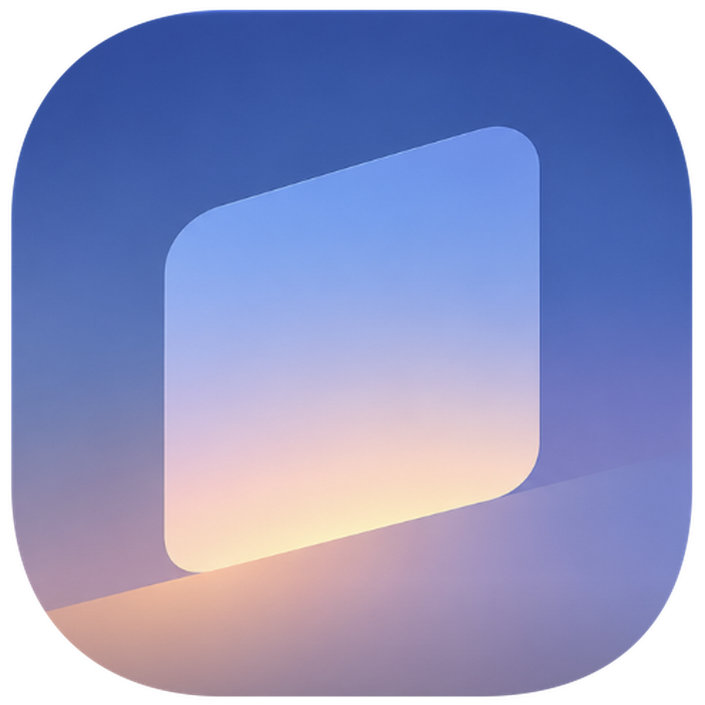
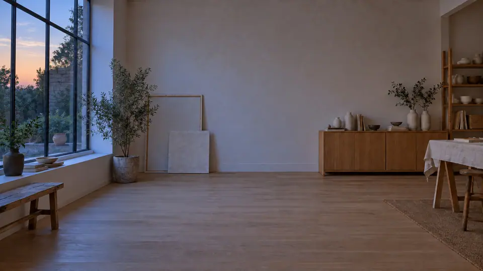

  

<h1 align="center">Janela</h1>

  A private virtual background for your Mac that follows your local time and weather.

  

  

Janela shows up as a camera in Zoom, Meet, and anything else. All video stays on your Mac.
The location box searches with Apple Maps as you type, and weather comes from Open-Meteo
using coordinates rounded to about a kilometre. Sun times are calculated on your Mac.

## How it works

Camera (1080p BGRA) → Robust Video Matting on the Neural Engine (720p) → motion-gated
temporal stabilizer → linear-light composite in Metal → CoreMediaIO camera sink.

- Each matte is composited onto the exact frame it came from, so edges don't lag motion.
- The stabilizer smooths the matte heavily where nothing moved, and opens fully where
  something did. This removes edge shimmer without ghosting.
- Below full alpha, colour comes from RVM's foreground estimate, so the old room doesn't
  halo around you.
- Nothing runs while no app reads the camera. The camera light stays off.

## Setup

The first launch asks for your city or postal code, in any language, and lets you pick a
background. Reopen Janela, or use the menu bar sun icon, to change either one. If you skip
the location, time of day comes from your time zone and the weather stays clear.

Weather refreshes every 3 hours and after your Mac wakes. A 24-hour forecast is cached, so
scenes keep changing between refreshes and while offline.

## Build

Needs Apple Silicon, macOS 14+, and the Command Line Tools. Xcode isn't required.

    python3 -m venv research/.venv
    research/.venv/bin/pip install torch coremltools
    git clone https://github.com/PeterL1n/RobustVideoMatting third_party/RVM
    # download rvm_mobilenetv3.pth from that repo's v1.0.0 release into models/
    research/.venv/bin/python research/export.py 1280 720 0.375 rvm_mp_720
    # first janela-render run compiles the model into ~/Library/Caches/Janela
    ./build_app.sh

Scene images live in `scenes/<name>/<weather>-<phase>.jpg`, where weather is clear, cloudy,
rain, snow or fog, and phase is dawn, morning, noon, afternoon, sunset or night.

## Virtual camera

macOS only lets signed system extensions publish a camera. Rather than requiring a paid
developer account, Janela publishes into OBS's open-source extension. The setup window
handles this: it downloads OBS if needed, verifies its checksum and Apple signature, starts
it hidden, and takes you to the one switch macOS needs you to turn on. OBS doesn't need to
be running afterwards.

## Tools

- `janela-render selftest scenes`: time, weather and scene checks.
- `janela-render <clip> <model> scenes <scene/weather/phase> <out.mp4> <alpha.raw>`:
  runs a clip through the production engine with stage timings.
- `camera-probe list`: lists camera devices and streams.
- `research/export.py`: exports RVM to Core ML.

## License

The code is GPL-3.0, because Robust Video Matting is GPL-3.0. The GPL does not cover the
images in `scenes/`. OBS is a separate project and its
extension is not distributed here.

